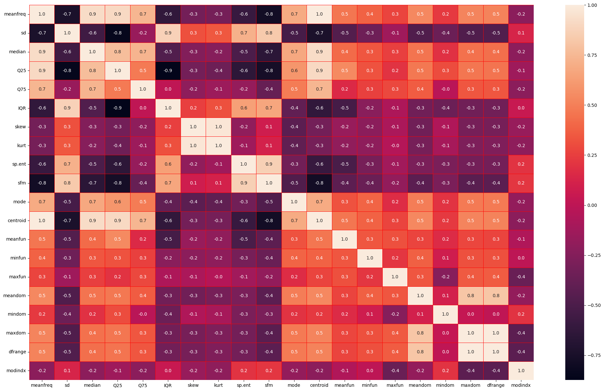
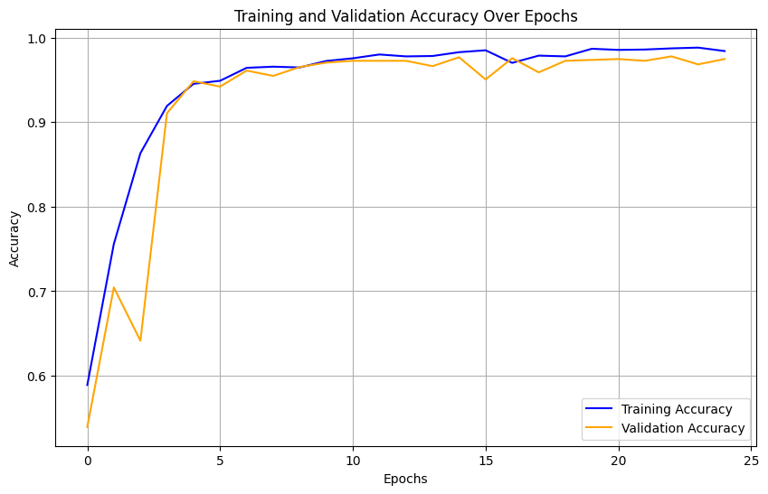
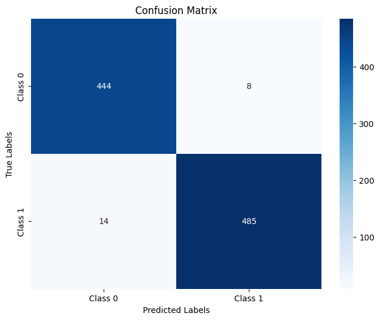
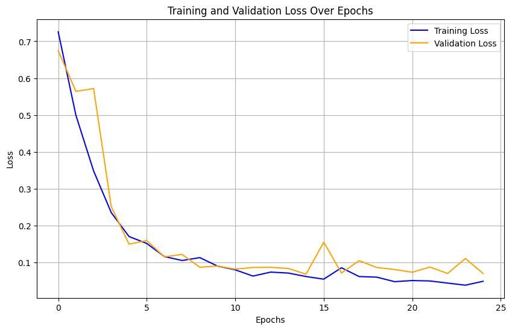

<div align="center">

# Voice-Based Gender Classification with RNNs
### تصنيف جنس المتحدث من الصوت باستخدام الشبكات العصبية المتكررة


🎓 Course: **Introduction to Deep Learning (CAI 421)** · Princess Nourah bint Abdulrahman University · 2024

🎓 المقرر: **مقدمة في التعلّم العميق (CAI 421)** · جامعة الأميرة نورة بنت عبدالرحمن · 2024

[English](#english) · [العربية](#arabic)

</div>

---

<a id="english"></a>

## Overview

Physiological differences in the vocal tract produce measurable differences in acoustic properties such as pitch and spectral shape. This project builds a deep learning model that classifies a speaker as **male or female** from **20 acoustic features** of their voice, using a stacked **Recurrent Neural Network (SimpleRNN)**, and extends it to make predictions on **new audio recordings** by extracting the same features with librosa.

Applications include voice-based user interfaces, speech analytics and personalization of speech systems.

## Highlights

- 🎯 **97.7% test accuracy** on 951 unseen samples, with a 0.98 F1-score for both classes
- 🧠 Stacked **SimpleRNN** architecture with **Batch Normalization** and **Dropout** for strong generalization
- 🛡️ **Early stopping** and **model checkpointing** to prevent overfitting (train/test loss gap of only 0.019)
- 🎙️ **End-to-end inference** on raw audio: features are extracted from an `.mp3`/`.wav` file with librosa, scaled, and classified

## Dataset

[Gender Recognition by Voice](https://www.kaggle.com/datasets/primaryobjects/voicegender) (Kaggle): **3,168** voice samples, perfectly **balanced** (1,584 male, 1,584 female), each described by 20 acoustic features including mean frequency, spectral entropy, spectral flatness, mean fundamental frequency, dominant frequency range and modulation index.



## Approach

| Step | Details |
|---|---|
| **Preprocessing** | Label encoding (male = 1, female = 0) · 70/30 train-test split · `StandardScaler` · reshaped to `(samples, 20, 1)` sequences |
| **Model** | `SimpleRNN(64)` → BatchNorm → Dropout(0.3) → `SimpleRNN(32)` → BatchNorm → Dropout(0.3) → `Dense(16)` → Dropout(0.2) → `Dense(1, sigmoid)` |
| **Training** | Adam (lr = 0.001) · binary cross-entropy · batch size 32 · up to 100 epochs with early stopping (patience 10) · metrics: accuracy and AUC |
| **Inference** | librosa extracts the 20 features from a new recording, which are scaled with the training scaler and passed to the model |

## Results

| Class | Precision | Recall | F1-score | Support |
|---|---|---|---|---|
| Female | 0.97 | 0.98 | 0.98 | 452 |
| Male | 0.98 | 0.97 | 0.98 | 499 |
| **Overall accuracy** | | | **0.977** | 951 |

| Training curves | Confusion matrix (0 = female, 1 = male) |
|---|---|
|  |  |



Training and validation curves track each other closely, and the final test loss (0.0685) is within 0.02 of the training loss, showing that the model generalizes well rather than memorizing the training data.

## Project Report

📄 The full [project report](docs/voice_gender_report.pdf) covers the background, algorithm explanation, advantages and limitations, methodology and pseudocode.

> **Note:** The notebook contains the **final, improved version** of the model, developed after the report was written. Where the two differ (for example the dataset size, architecture details or train-test split described in the report's appendix), the notebook and the results in this README reflect the latest version.

## Repository Structure

```
├── notebooks/
│   └── voice_gender_rnn.ipynb   # full pipeline: preprocessing → RNN → training → evaluation → audio inference
├── docs/
│   └── voice_gender_report.pdf  # project report
├── assets/                      # result charts
├── requirements.txt
└── README.md
```

## How to Run

1. Download `voice.csv` from the [Kaggle dataset](https://www.kaggle.com/datasets/primaryobjects/voicegender).
2. Install the dependencies: `pip install -r requirements.txt`
3. Open `notebooks/voice_gender_rnn.ipynb` (or Google Colab), update the CSV path and run all cells.
4. To classify your own voice, set `audio_file_path` in the last cell to an audio recording.

## Future Work

- Align the live-audio feature extraction more closely with the dataset's original feature pipeline for more reliable real-world predictions
- Compare against LSTM, GRU and CNN models on raw spectrograms
- Evaluate robustness across accents, ages, languages and noisy recording conditions

---

<a id="arabic"></a>
<div dir="rtl">

## نظرة عامة

تؤدي الفروق الفسيولوجية في الجهاز الصوتي إلى فروق قابلة للقياس في الخصائص الصوتية مثل حدّة الصوت وشكل الطيف الترددي. يبني هذا المشروع نموذج تعلّم عميق يصنّف المتحدث إلى **ذكر أو أنثى** بالاعتماد على **20 خاصية صوتية**، باستخدام **شبكة عصبية متكررة (SimpleRNN)** متعددة الطبقات، ويمتد ليتنبأ على **تسجيلات صوتية جديدة** عبر استخراج الخصائص نفسها بمكتبة librosa.

ومن تطبيقاته: الواجهات الصوتية، وتحليل الكلام، وتخصيص أنظمة التعرف على الصوت.

## أبرز النقاط

- 🎯 **دقة 97.7%** على 951 عينة لم يرها النموذج من قبل، ومقياس F1 يبلغ 0.98 للفئتين
- 🧠 شبكة **SimpleRNN** متعددة الطبقات مع **Batch Normalization** و **Dropout** لتعميم أفضل
- 🛡️ **الإيقاف المبكر** وحفظ أفضل نموذج لتجنب الإفراط في التعلّم، والفرق بين خسارة التدريب والاختبار 0.019 فقط
- 🎙️ **تنبؤ متكامل من الصوت مباشرة**: استخراج الخصائص من ملف صوتي، ثم توحيد مقياسها، ثم تصنيفها

## البيانات

مجموعة بيانات [Gender Recognition by Voice](https://www.kaggle.com/datasets/primaryobjects/voicegender) من Kaggle: ‏**3,168** عينة صوتية **متوازنة** تماماً (1,584 ذكر و 1,584 أنثى)، ولكل عينة 20 خاصية صوتية.

## النتائج

- **الدقة الكلية: 97.7%** على بيانات الاختبار
- **الإناث:** Precision ‏0.97 و Recall ‏0.98
- **الذكور:** Precision ‏0.98 و Recall ‏0.97

## التقنيات المستخدمة

Python · TensorFlow / Keras · scikit-learn · librosa · Pandas · NumPy · Matplotlib · Seaborn

## تقرير المشروع

📄 [تقرير المشروع](docs/voice_gender_report.pdf) يشرح الخلفية العلمية، وآلية عمل الخوارزمية، والمزايا والقيود، والمنهجية.

> **ملاحظة:** الكود يمثّل **النسخة النهائية المحسّنة** من النموذج، وقد طُوّرت بعد كتابة التقرير. وعند وجود اختلاف بينهما (مثل حجم البيانات أو تفاصيل المعمارية أو نسبة تقسيم البيانات في ملحق التقرير)، فإن الكود والنتائج المعروضة هنا تعكس أحدث نسخة.

</div>
